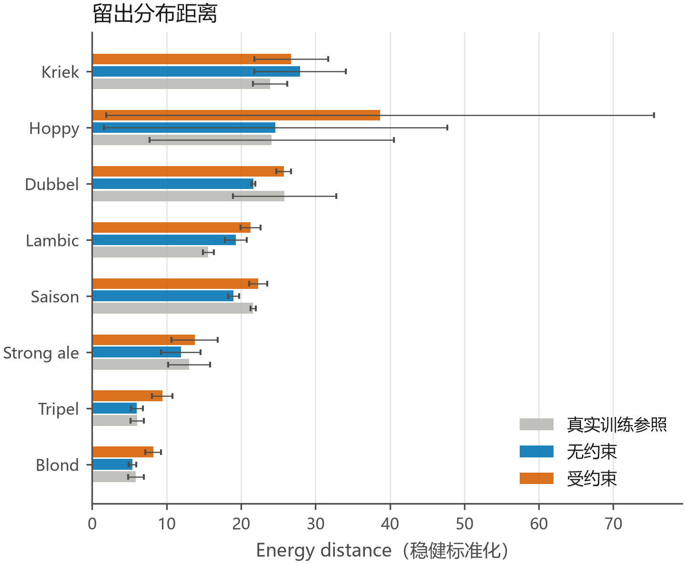

# Q3 留出验证：硬约束合规，但真实性证据仍来自无约束谱与真实留出样本

## 执行摘要

- 状态：`completed_with_caveats`。本轮没有修改正式 `data/processed/q3_runs`，新增结果仅位于本运行的 `q3/` 目录，另写本报告与 `state/03_q3.json`。
- 在 8 个风格、3 个分层留出种子、2 种 Copula 相关结构的 48 个审计单元中，无约束生成的平均 energy distance 为 **16.984**，真实训练样本参照为 **17.007**；MMD² 分别为 **0.1733** 与 **0.1746**。这说明无约束谱在该有限留出协议下与真实样本间波动处于相近量级，但不能证明分布完全真实，且小风格每折仅有 3–9 个真实留出样本。
- 受约束谱的平均 energy distance 升至 **20.766**、MMD² 升至 **0.2040**；两项距离都在 **42/48** 个单元中劣于配对无约束谱。90% 边际区间对真实留出点的覆盖率由 **91.4%** 降至 **87.7%**，生成值落在真实留出 `[min,max]` 内的比例由 **59.6%** 降至 **58.2%**。这是一致的分布选择/压缩证据。
- 硬约束合规率由无约束谱的 **13.5%** 提升为 **100%**；真实训练样本参照仅 **8.5%**。实际候选接受率均值 **12.75%**、范围 **4.79%–28.49%**，无任何折触发压缩兜底。**零违规只证明阈值合规，不证明真实性。**
- Ledoit–Wolf 收缩协方差 Copula 的无约束 energy distance 均值为 **16.091**，原实现为 **17.878**，但配对中只赢 **15/24**，MMD² 均值反而略高（0.1740 vs 0.1726）。证据不足以替换现有 Gaussian Copula；潜变量因子 Copula 没有项目内可靠实现与因子数选择协议，本轮不临时构造。



图注：8 个风格在 3 个分层留出种子、2 种 Copula 相关结构下的 energy distance 均值与标准差。三态使用相同稳健标准化；误差条合并了划分、抽样和模型差异，不是置信区间。AI 辅助绘图，数值由 `holdout_seed_metrics.csv` 现场聚合。

## 1 验证设计与证据边界

### 1.1 风格分层真实留出

每个随机种子都在 8 个目标风格内独立留出约 30% 的真实啤酒；全局 Copula 和风格条件边际只用其余真实样本拟合。每个风格的训练/留出量为：Tripel 20/8、Blond 22/9、Strong ale 13/5、Hoppy 12/5、Lambic 8/3、Kriek/Dubbel/Saison 7/3。每个审计单元同时记录：

1. **真实样本参照**：同风格训练真实样本与真实留出样本；
2. **无约束基线**：Copula 生成、未做缺陷阈值拒绝；
3. **受约束结果**：与无约束谱同种子、同边际，经三项缺陷阈值拒绝后保留。

MMD² 和 energy distance 均在训练真实样本的中位数/IQR 稳健标准化后计算；三态共用同一标准化与 MMD 带宽。边际覆盖同时报告“真实留出点落入来源分布 90% 区间”的覆盖率，以及“来源值落入真实留出 `[min,max]`”的比例。

### 1.2 整风格留一诊断

若某目标风格的全部样本都留出，现有方法无法识别该风格的条件边际。本轮只做显式标注的全局回退：从其余风格拟合 Copula，令目标边际 `λ=0`，不把它称作目标风格生成器。`loso_metrics.csv` 中的 16 行结果仅用于暴露这一方法缺口；由于风格真实样本总量只有 10–31，拆半后的真实—真实参照非常不稳定，不据此排名模型。

## 2 三态留出结果

下表为每种模型 24 个风格×种子单元的均值。真实样本参照在两个模型下相同。

| 相关结构 | Energy 真实 / 无约束 / 受约束 | MMD² 真实 / 无约束 / 受约束 | 90%覆盖 真实 / 无约束 / 受约束 | 留出取值域内比例 真实 / 无约束 / 受约束 | 硬约束合规 真实 / 无约束 / 受约束 |
|---|---:|---:|---:|---:|---:|
| 原 Gaussian eig+ridge | 17.008 / 17.878 / 20.496 | 0.1746 / 0.1726 / 0.2046 | 78.7% / 91.4% / 87.4% | 63.6% / 59.7% / 58.2% | 8.5% / 13.4% / 100% |
| Ledoit–Wolf 收缩 | 17.008 / 16.091 / 21.037 | 0.1746 / 0.1740 / 0.2034 | 78.7% / 91.4% / 88.0% | 63.6% / 59.6% / 58.3% | 8.5% / 13.5% / 100% |

90% 区间覆盖高于真实训练参照并不等于更真实：合成样本量为 128，且条件边际含全局混合成分，区间更稳定或更宽都会提高覆盖；与之并列的“留出取值域内比例”反而低于真实参照。因此覆盖率只能与距离、支持域和小样本限制一起解释。

### 2.1 分风格结果

以下对两个模型、三个种子取均值。`接受率`是阈值拒绝前候选被保留的比例。

| 风格 | 真实训练/留出 | 接受率 | Energy 无约束 | Energy 受约束 | Energy 真实参照 | 约束代价 C−U | 90%覆盖 无约束/受约束/真实 |
|---|---:|---:|---:|---:|---:|---:|---:|
| Blond | 22 / 9 | 5.5% | 5.417 | 8.202 | 5.885 | +2.785 | 90.3% / 86.2% / 84.8% |
| Dubbel | 7 / 3 | 15.8% | 21.686 | 25.734 | 25.849 | +4.049 | 92.4% / 89.5% / 70.6% |
| Hoppy | 12 / 5 | 8.4% | 24.635 | 38.692 | 24.122 | +14.057 | 90.8% / 84.5% / 79.5% |
| Kriek | 7 / 3 | 23.3% | 27.941 | 26.735 | 23.904 | −1.207 | 89.6% / 87.1% / 71.2% |
| Lambic | 8 / 3 | 13.5% | 19.298 | 21.279 | 15.598 | +1.981 | 91.2% / 90.0% / 78.7% |
| Saison | 7 / 3 | 10.3% | 18.985 | 22.296 | 21.619 | +3.311 | 94.8% / 91.3% / 75.9% |
| Strong ale | 13 / 5 | 18.1% | 11.912 | 13.770 | 13.028 | +1.858 | 90.0% / 86.5% / 81.7% |
| Tripel | 20 / 8 | 7.1% | 5.998 | 9.423 | 6.054 | +3.425 | 92.1% / 86.8% / 87.2% |

Hoppy 的种子波动最大，不能把单一 seed 的改善或恶化写成稳定结论。Kriek 是唯一平均 energy distance 在约束后下降的风格，但其真实留出每折只有 3 条，不能据此反转总体结论。

## 3 约束合规与分布压缩必须分开写

- **硬约束合规**：受约束谱 48/48 个单元均为 100% 合规；无约束谱平均仅 13.5%，真实训练样本参照 8.5%。这回答的是阈值约束是否执行成功。
- **无约束生成真实性**：无约束谱的平均 MMD²/energy 与真实—真实参照接近，但跨种子和风格波动很大；其中 seed 7 的 Hoppy energy 明显异常。只能写成“在当前小样本留出中处于真实样本波动量级”，不能写成“已证明真实”。
- **约束造成的分布选择/压缩**：平均候选接受率只有 12.75%；energy 与 MMD² 都在 42/48 个单元中变差，90% 覆盖在 46/48 个单元中下降。正式 `q3_runs` 已记录缺陷列中位数的大幅下移，本轮留出结果与该机制一致。
- **证据量**：每单元生成 128 条只是稳定估计模拟分布；真实证据仍是原始 250 款啤酒和各折 3–9 条真实留出。不得把 128×48 条合成行当作新增样本量。

`q3/constraint_failure_samples.csv` 保存 144 条无约束候选违规示例（每个风格×种子×模型最多 3 条），仅用于排查阈值触发原因，不作为额外统计证据。

## 4 收缩 Copula 对照

Ledoit–Wolf 的正态分数协方差收缩强度为 0.103–0.111。与原实现逐折配对：

- 无约束 energy distance 的均值差 `LW−原实现 = −1.787`，中位数差 −0.227，Ledoit–Wolf 在 15/24 折更低；
- 无约束 MMD² 的均值差为 +0.0014，Ledoit–Wolf 仅在 11/24 折更低；
- 受约束 energy distance 的均值差为 +0.541，但中位数差 −0.367，Ledoit–Wolf 在 14/24 折更低；
- 模型差异小于风格/划分波动，且不同距离指标方向不一致。

因此本轮不建议替换正式 Gaussian eig+ridge 实现。这里比较的是可靠库实现的**协方差收缩 Gaussian Copula**；潜变量因子 Copula 需要因子数选择、旋转/载荷稳定性和留出协议，项目内没有可安全复用实现，列为方法缺口而未制造新模型。

## 5 既有实现审查

- `q3_copula.py`：全局正态分数相关结构、CDF 混合条件边际、阈值拒绝和迁移约束均可复用；正式全样本拟合的原始最小特征值为正，未发生特征值裁剪。
- `q3_generate.py`：已配对保存无约束/受约束谱，并区分真实样本缺陷率；但正式 KS 使用同一风格全样本定义边际和评估，不是未见样本泛化证据。本报告以真实留出协议补足。
- `q3_transfer.py`：逐样本“不恶化”与阈值约束有断言；其零违规同样只证明迁移约束合规。
- `q3_verify.py`：能重算正式六项验收，但脚本内部固定调用仓库 `.venv`，当前 worktree 没有可用该解释器。本轮没有修改它，改用独立 nightly 不变量检查。
- 正式 `q3_runs/README.md` 中“无约束谱代表真实化学画像”的措辞应降级为“全样本边际拟合参照”；在论文中只有真实留出结果可支持有限的泛化表述。

输入脚本/正式摘要 SHA256：

- `q3_copula.py`: `C2427D53A9818B614552EB2047AF3B2AF07873DD80D2439E059313C121FD37EB`
- `q3_generate.py`: `3CF4B939E2F06C57D20F9DAF7A1750A71179652CDCC6F3CD9095680BB2A900A6`
- `q3_transfer.py`: `D8E32D0A6B81F7643B06BBED8EC2FCEF5598C042752D4EDD05EAD6B3596774F8`
- `q3_verify.py`: `9FEFCFCF56C4312AF71E59B4983B254863815349F1810A926C821D05E140707D`
- `q3_runs/generation_summary.csv`: `88E2CF3312809985A20FEBAE8DB7E15740D8690DDA4DF0AD362210365638FCD3`

## 6 复现与检查

```powershell
# 从目标 worktree 根目录运行；脚本只重写本 nightly/q3 目录
C:\Windows\System32\WindowsPowerShell\v1.0\powershell.exe `
  -NoProfile -ExecutionPolicy Bypass `
  -File .\data\processed\nightly\overnight-q123-20261030\q3\reproduce.ps1
```

已完成：

- `q3_bounded_validation.py` 语法编译通过；
- 48 行分层留出结果、16 行整风格留一结果、三态字段、种子/风格/模型全集、有限数、100% 受约束合规和零 fallback 不变量通过；
- `reproduce.ps1` 复跑后 6 个核心 CSV/JSON 与前一次逐字节一致；
- PNG/PDF 图双输出并人工查看，无标签裁切或缺失图形；
- `git diff --check` 通过；分支仍为 `night/overnight-q123-20261030`；没有提交、推送或生成提交包。

环境限制与恢复过程见 `q3/failures.log`。AI 辅助了审计脚本、图和本报告的生成；关键口径、三态比较、样本量限制与结论边界已按上述不变量逐项核对。
